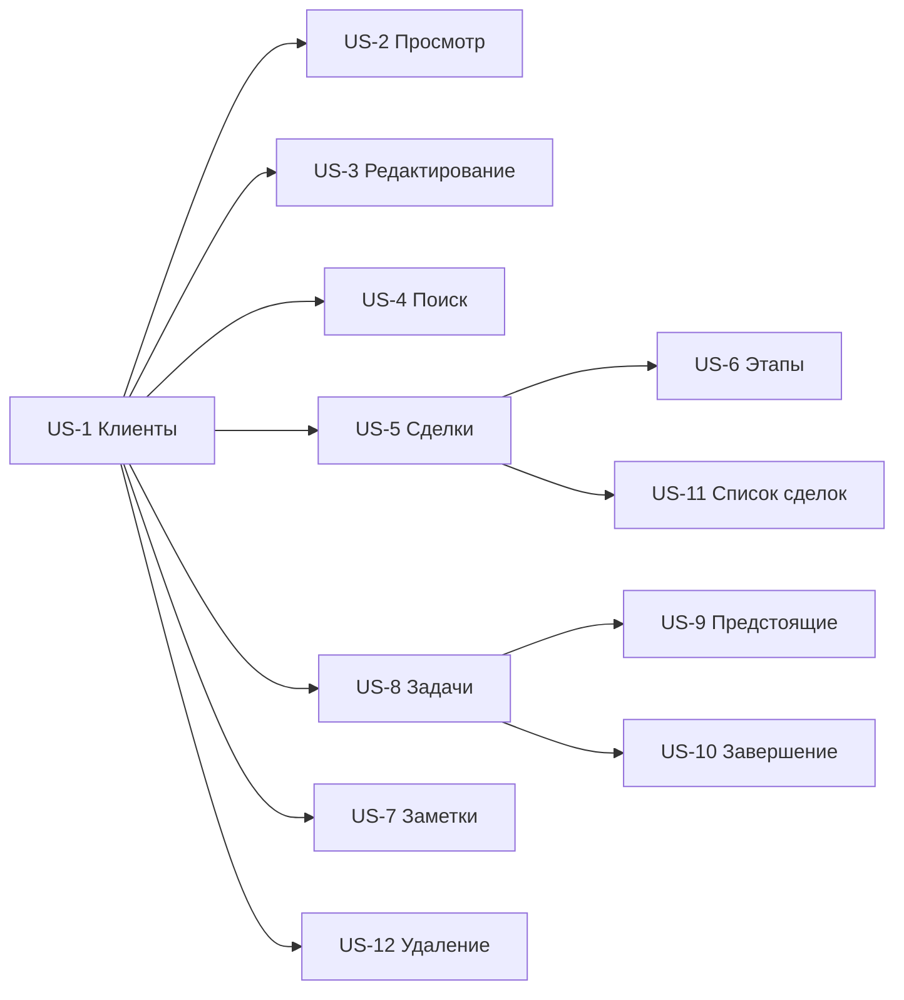

# Задание 1.5 Сетевой график и прогноз
1 

История (4 периодов): [1, 2, 3, 4]; среднее 2.50
Бэклог: 12 задач, симуляций: 10000

| Периоды  | Доля  | Накоп   |
|--------  |------ |---------|
|     3    |  1.7% |    1.7% |   
|     4    |  24.7%|   26.3% |  
|     5    | 39.7% |   66.0% |  
|     6    | 24.0% |   90.0% |  
|     7    |  8.0% |   98.1% |  
|     8    |  1.7% |   99.7% |  
|     9    |  0.2% |  100.0% |   
|     10   |  0.0% |  100.0% |  

| История | Уч. 1 | Уч. 2 | Уч. 3 | Разброс |
|----- |---|---|---|------|
| US-1 | 5 | 3 | 5 | есть |
| US-2 | 3 | 2 | 3 | есть |
| US-3 | 3 | 3 | 2 | есть |
| US-4 | 3 | 3 | 3 | нет  |
| US-5 | 5 | 5 | 8 | есть |
| US-6 | 5 | 3 | 5 | есть |
| US-7 | 2 | 2 | 3 | есть |
| US-8 | 5 | 5 | 5 | нет  |
| US-9 | 2 | 3 | 2 | есть |
| US-10 | 2 | 2 | 1 | есть |
| US-11 | 3 | 3 | 5 | есть |
| US-12 | 2 | 2 | 2 | нет |

С вероятностью 50% бэклог будет выполнен не позже чем за 5 нед.
С вероятностью 70% бэклог будет выполнен не позже чем за 6 нед.
С вероятностью 85% бэклог будет выполнен не позже чем за 6 нед.
С вероятностью 95% бэклог будет выполнен не позже чем за 7 нед.
